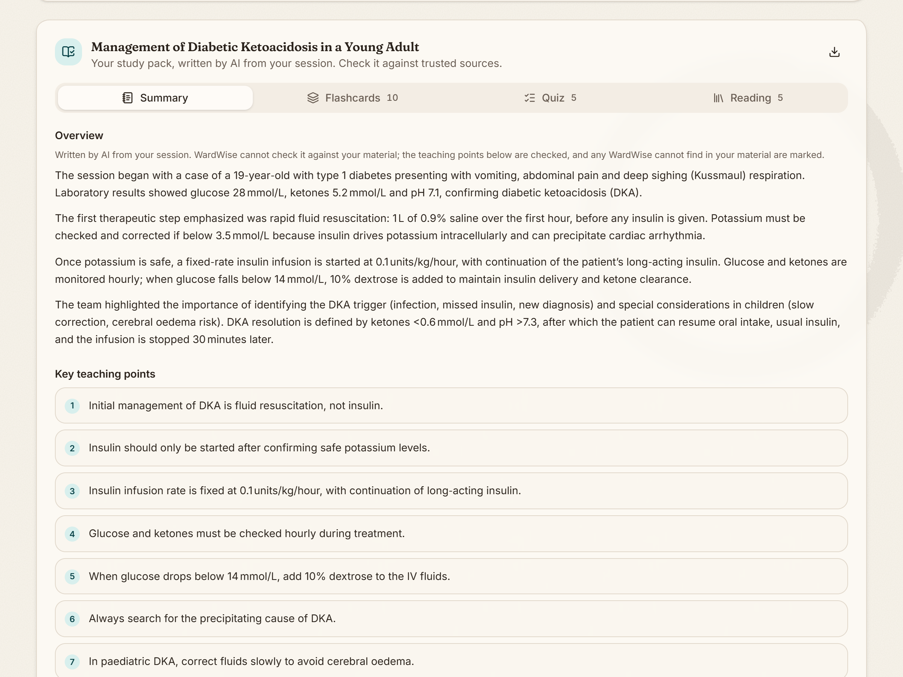

# WardWise

*Every ward round, turned into a lesson.*

WardWise turns ward-round teaching into a study pack. Record a teaching round, take photos of your handwritten notes, or add the slides, and about a minute later you have a summary, flashcards, an exam-style quiz and further reading from credible sources. Every teaching point carries a quote that WardWise checks against the session itself.



**Status:** a working MVP. WardWise records a round or accepts an audio file and transcribes it with Whisper, reads photos of handwritten notes and PDF or PowerPoint slides, lets you correct what it heard and read, and writes the study pack. Packs are saved in your browser, not on the server, and you can reopen, export and import them. Next: hosting behind an access code, then a chat about the session (see `docs/plan.md`).

> WardWise is for teaching material only: role-played rounds, lectures, and your own notes. Do not upload anything that could identify a patient.

## How it works
- **Front end:** React, Tailwind CSS, shadcn/ui, Motion
- **Back end:** Python, FastAPI
- **AI:** any OpenAI-compatible provider (Groq by default), set in configuration
- **Checks:** the AI's reply must match a fixed schema; every teaching point and flashcard quotes the session, and WardWise marks any quote it cannot find. Passages that no item covers are listed, so the student can read what the summary may have missed.
- **Further reading:** links come from PubMed, StatPearls, Wikipedia, five teaching channels on YouTube, and the search pages of Radiopaedia and MSD Manuals. The AI only suggests search terms; it never writes links.

## Running it locally
Run the back end and the front end in two terminals.

Back end (needs Python 3.13):
```
cd backend
py -3.13 -m venv .venv
.venv\Scripts\activate
pip install -r requirements-lock.txt
copy .env.example .env
uvicorn app.main:app --reload --port 8000
```
Before starting the server, put your AI provider key in `.env` as `LLM_API_KEY`. Two keys are optional: `YOUTUBE_API_KEY` (a free YouTube Data API v3 key; without it, videos are left out) and `NCBI_API_KEY` (faster PubMed and StatPearls lookups). The API answers at http://localhost:8000, with interactive documentation at http://localhost:8000/docs. Run the tests with `pytest`.

Front end (needs Node 24):
```
cd frontend
npm install
npm run dev
```
Then open http://localhost:5173. Run the front-end tests with `npm test`.
